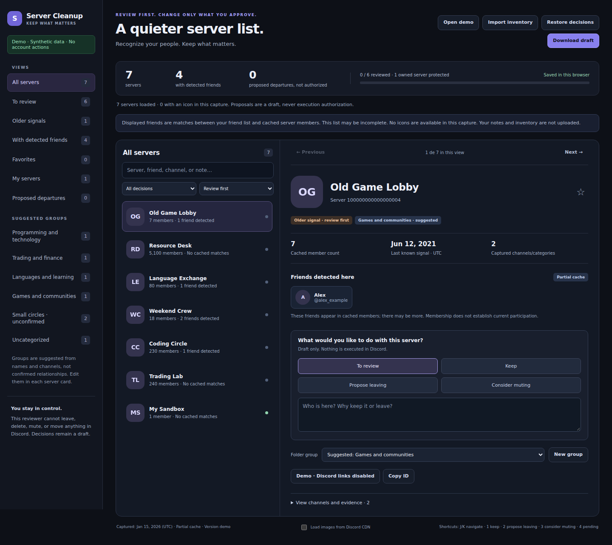

# Vencord Server Cleanup

A local-first toolkit for reviewing Discord servers, leaving the ones you choose, and organizing the rest into folders. Built for people who already use **Vencord**.

**Capture → review → preview → explicitly approve → execute → verify.**



_The screenshot uses fictional servers and friends. No real account data is included._

## What it does

- Captures server icons, available member counts, cached friend matches, channel timestamps, and your current folder order.
- Opens a standalone reviewer with search, editable folder groups, favorites, notes, and one-server-at-a-time navigation.
- Keeps draft decisions and missing-server history locally, with downloadable backups.
- Generates an account-bound plan and a separate executor for departures, optional owned-server deletions, and folder organization.
- Verifies observed results against the exact plan. No automatic muting, message deletion, or private-group cleanup.

There is no backend, login form, token extraction, or required Vencord plugin installation. The reviewer needs only a browser; planning and executor generation require **Node.js 20+**. Runtime scripts have no npm dependencies.

## Start here

1. Download or clone this repository.
2. In your logged-in Vencord desktop client, open DevTools → Console. Inspect and run `collectors/servers.js`, then `collectors/folders.js`.
3. Open `index.html` locally and import the downloaded server inventory. Use **Open demo** first if you want a safe preview.
4. Review each server, set folder groups, and download your decisions draft.
5. Follow the [workflow guide](docs/workflow.md) to create a preview, approve the exact operations, and build your private executor.

The collector downloads are named `discord-servers-visual.json` and `discord-folders-current.json`. Keep them, your decisions, and generated scripts private—preferably in the git-ignored `data/` and `dist/` directories.

```sh
git clone https://github.com/kevscec/vencord-server-cleanup.git
cd vencord-server-cleanup

# Save your own captures as data/inventory.json, data/folders.json,
# and the reviewer export as data/decisions.json.
npm run plan -- --inventory data/inventory.json --decisions data/decisions.json --folders data/folders.json

# Inspect data/plan.json before approving anything.
npm run build:executor -- --plan data/plan.json --authorize-leave --authorize-folders
```

These commands only generate local files. To run approved operations, inspect `dist/execute-cleanup.js`, paste it into your Vencord console, and use its **Start approved cleanup** button. A plan containing owned-server deletions also requires separate deletion flags and exact-ID confirmation; see the guide.

## Safety and limitations

- **Discord client modifications and personal-account automation may violate Discord's terms and put your account at risk.** This is unofficial, unsupported by Discord, and not an official bot/OAuth integration.
- **Owned-server deletion is irreversible and affects every member.** A folder backup cannot undo a deletion or restore departed memberships.
- Friend matches and timestamps are **cache-partial**. No matches does not mean no friends; old timestamps do not prove inactivity. Message dates in voice channels do not establish voice usage.
- The collectors do not request additional members, read message bodies, inspect private groups, or change account state.
- The reviewer performs no account actions. Images are disabled by default; enabling them requests validated icon/avatar URLs from Discord CDN.
- The executor uses native authenticated client controls. It stops on account changes, unexpected membership, ownership changes, errors, or unverified results. It never retries mutations automatically. Stop cannot cancel an in-flight request.
- Native Discord internals can change. If preflight fails, download the diagnostic result and stop; do not disable security protections or blindly rerun a partial cleanup.

See [security and privacy](SECURITY.md) and the [project structure](docs/development.md).

## For coding agents

Start with [AGENTS.md](AGENTS.md), the canonical architecture, test, and safety guide. Claude Code and GitHub Copilot have short instruction entrypoints that point to it. `npm run verify` is the shared local/CI gate; development never requires a live Discord account or credentials.

## Development

```sh
npm ci --ignore-scripts
npx playwright install chromium
npm run verify
```

CI uses synthetic fixtures and mocked native controls—never a Discord account. The demo is isolated from real review storage and cannot be used to generate an execution plan.

## License

MIT. No Discord or Vencord code is bundled. This project is not affiliated with or endorsed by Discord or Vencord.
